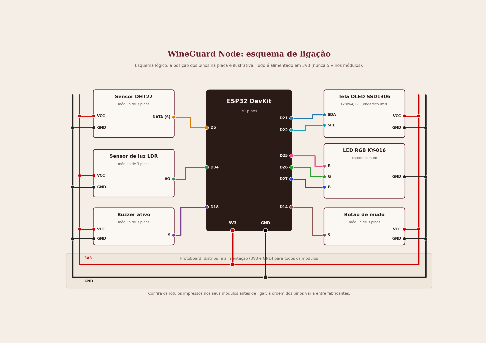
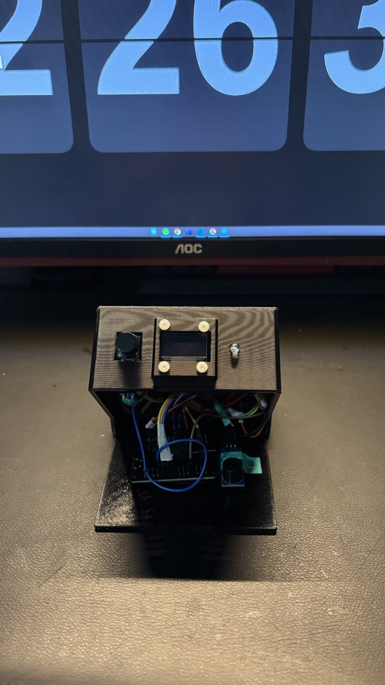

# Manual de instalação

**WineGuard: monitoramento de adegas com IoT** · grupo marcha.dev · CP5 Vinheria Full · versão de 27/10/2026

Este manual ensina a montar o sistema do zero: o **Node** (o aparelho que fica na adega), a **plataforma na nuvem**, o **backend** e o **dashboard**. Para usar o sistema depois de instalado, veja o [Manual de operação](manual-operacao.md).

## 1. O que será instalado

| Parte | O que é | Onde roda |
|---|---|---|
| **WineGuard Node** | ESP32 com sensores e avisos (LED, buzzer e tela), numa caixa impressa em 3D | Na adega |
| **Plataforma FIWARE** | Mosquitto, IoT Agent, Orion, STH-Comet e MongoDB, em Docker | Instância na AWS |
| **Backend** | API em FastAPI que confere os limites e abre e fecha alertas, em contêiner Docker | Mesma instância (porta 8000) |
| **Dashboard** | Painel web em React | No computador (`npm run dev`) |

O caminho dos dados: o Node envia as leituras por Wi-Fi (MQTT) para a nuvem; o backend avalia os limites e manda os comandos de volta; o dashboard mostra tudo.

## 2. O que você precisa

**Materiais do Node** (lista completa em `hardware/lista-de-materiais.md`):

| Item | Qtd. |
|---|---|
| ESP32 DevKit (30 pinos) | 1 |
| Sensor DHT22 (módulo de 3 pinos) | 1 |
| Sensor de luz LDR (módulo de 3 pinos, saída AO) | 1 |
| Buzzer ativo (módulo de 3 pinos) | 1 |
| LED RGB KY-016 | 1 |
| Tela OLED SSD1306 128x64 (I2C) | 1 |
| Botão (módulo de 3 pinos) | 1 |
| Protoboard de 400 pontos, cabos Dupont e cabo USB **de dados** | 1 kit |
| Caixa 3D (PLA) e parafusos pequenos | 1 |

**Programas no computador:**

- **Arduino IDE** com o pacote de placas **esp32 (Espressif Systems)**, versão 3.3.x.
- **Git** e um terminal (no Windows, o Git Bash).
- **Node.js** 22 ou mais novo (traz o `npm`).
- **Python** 3.12 ou mais novo (só se for rodar o backend no próprio computador).

**Na nuvem:** uma conta do **AWS Academy Learner Lab**, com uma instância Ubuntu (usamos uma `t3.medium`) com **Docker** e o plugin **Docker Compose** instalados.

**Rede:** um Wi-Fi de **2,4 GHz** (o ESP32 não conecta em 5 GHz).

## 3. Montar o Node



O desenho mostra quem liga em quem (não a posição física dos pinos). Todos os módulos são alimentados em **3V3**, distribuído pelo protoboard.

> **Atenção:** nunca ligue 5 V nos módulos. Os pinos do ESP32 não toleram 5 V. E confira os rótulos impressos nos módulos: a ordem dos pinos (VCC, GND, sinal) muda entre fabricantes.

| Módulo | Pino do módulo | Liga em |
|---|---|---|
| DHT22 | VCC, GND, DATA | 3V3, GND, **D5** |
| LDR | VCC, GND, AO | 3V3, GND, **D34** |
| Buzzer ativo | VCC, GND, S | 3V3, GND, **D18** |
| LED RGB KY-016 | R, G, B, GND | **D25** (vermelho), **D26** (verde), **D27** (azul), GND |
| OLED SSD1306 | VCC, GND, SDA, SCL | 3V3, GND, **D21**, **D22** |
| Botão de mudo | VCC, GND, S | 3V3, GND, **D14** |



**Organização da caixa:** OLED, LED, DHT22 e botão ficam na tampa. O DHT22 fica afastado do ESP32 (que esquenta) e com abertura para o ar. O LDR fica separado do LED RGB, para o próprio LED não enganar o sensor.

### Testar a montagem, um componente por vez

1. **OLED:** ao ligar, aparece o logo do WineGuard. Se a tela ficar apagada, confira SDA e SCL.
2. **DHT22:** com o monitor serial a 115200, a temperatura e a umidade aparecem. Aqueça o sensor com a mão para ver mudar.
3. **LDR:** cubra o sensor. O valor de luz deve **cair**. Se **subir**, coloque `#define LDR_INVERTIDO 0` no `config.h`.
4. **LED e buzzer:** com o ambiente fora dos limites, o LED acende e o buzzer toca. Se o buzzer tocar direto em repouso, coloque `#define BUZZER_ATIVO_EM_LOW 1`.
5. **Botão:** um aperto rápido liga o mudo (aparece "MUDO" na tela) e outro desliga. **Não aperte o botão ao ligar o Node:** é nesse momento que o firmware descobre a polaridade do módulo.

## 4. Gravar o firmware

1. Clone o repositório: `git clone https://github.com/enzopereira1701/wineguard.git`
2. Na Arduino IDE, instale as bibliotecas (Ferramentas, Gerenciar Bibliotecas), aceitando as dependências:

| Biblioteca | Versão usada |
|---|---|
| PubSubClient | 2.8 |
| Adafruit GFX Library | 1.12.6 |
| Adafruit SSD1306 | 2.5.17 |
| DHT sensor library | 1.4.7 |
| Adafruit Unified Sensor e Adafruit BusIO | 1.1.15 e 1.17.4 |

3. Na pasta `hardware/firmware/wineguard_node/`, copie `config.example.h` para **`config.h`** (o `config.h` guarda sua senha de Wi-Fi e **não vai para o GitHub**). Preencha:

| Opção | O que colocar |
|---|---|
| `SIMULACAO_WOKWI` | `0` (placa física) |
| `WIFI_SSID` e `WIFI_PASSWORD` | O nome **exato** e a senha da rede de 2,4 GHz |
| `MQTT_BROKER` | O **IP público da instância** (muda a cada sessão do lab; veja a seção 5) |
| `API_KEY` e `DEVICE_ID` | Os valores do cadastro do dispositivo (veja a seção 7) |

4. **Abra o sketch direto da pasta do repositório** (File, Open, `wineguard_node.ino`). A IDE pode guardar outra cópia do firmware, e é essa cópia que ela grava.
5. Placa **DOIT ESP32 DEVKIT V1** (ou **ESP32 Dev Module**), porta COM correta, e clique em **Upload**.
6. Abra o **monitor serial** (115200). Esperado: `Conectando ao broker: <IP>` e `Conectado ao broker MQTT!`.

> Se a gravação falhar com `Invalid head of packet (0x80)`: baixe o **Upload Speed** para 115200, use um cabo USB curto e **de dados**, ligado direto no computador.

## 5. Plataforma FIWARE na AWS

1. No AWS Academy, abra o Learner Lab e clique em **Start Lab**. Espere o círculo ficar **verde**.
2. No console EC2, abra a instância e anote o **IP público** (ele **muda a cada sessão**).
3. Abra o **Security Group** da instância e deixe **apenas** estas portas de entrada abertas (origem `0.0.0.0/0`):

| Porta | Para quê |
|---|---|
| **22** | SSH (o terminal da instância) |
| **1883** | MQTT, para o Node |
| **8000** | API do backend, para o dashboard |

   As portas do FIWARE (1026, 4041 e 8666) e a do MongoDB (27017) **não** precisam ficar abertas: o backend fala com elas por dentro do Docker.

4. Abra o terminal da instância (EC2 Instance Connect) e suba a base FIWARE do professor (material *FIWARE Descomplicado*, do Prof. Fábio H. Cabrini), que fica em `~/fiware`:

```bash
cd ~/fiware
sudo docker compose up -d
sudo docker ps
```

   Devem aparecer os contêineres `fiware-mosquitto`, `fiware-iot-agent`, `fiware-orion`, `fiware-sth-comet`, `fiware-mongo-internal` e `fiware-mongo-historical`, todos `Up`. Os dados ficam em volumes do Docker e **sobrevivem ao End Lab**.

> Se o Mosquitto for reiniciado, reinicie também o IoT Agent: `sudo docker restart fiware-iot-agent`. Sem isso o Node reconecta, mas os dados não chegam ao Orion.

## 6. Backend (contêiner na instância)

Na instância:

```bash
cd ~
git clone https://github.com/enzopereira1701/wineguard.git
cd ~/wineguard/backend
cp .env.example .env
```

Edite o `~/wineguard/backend/.env` (por exemplo com `nano .env`) e deixe:

```
FIWARE_HOST=host.docker.internal
FIWARE_SERVICE=vin_demo
FIWARE_SERVICEPATH=/adega1
CORS_ORIGINS=*
FIWARE_APIKEY=winedemo
NOME_VINHERIA=Vinheria Demo
```

Depois, copie o serviço do backend para o Compose do FIWARE e suba:

```bash
cp ~/wineguard/fiware/docker-compose.backend.yml ~/fiware/docker-compose.override.yml
cd ~/fiware
sudo docker compose up -d --build wineguard-backend
sudo docker logs --tail 15 wineguard-backend
```

O build leva de 1 a 2 minutos. No log deve aparecer `Uvicorn running on http://0.0.0.0:8000`. O contêiner tem `restart: unless-stopped`: depois de um novo Start Lab ele sobe sozinho.

**Teste no seu computador** (troque `IP` pelo IP público da instância):

```bash
curl http://IP:8000/api/vinherias
```

Deve voltar um JSON com a "Vinheria Demo". Para atualizar o código depois: `git pull` em `~/wineguard` e repita o `docker compose up -d --build wineguard-backend`.

> Rode **um backend só** por vez. Com o contêiner no ar, não suba outro no computador: dois backends duplicam os alertas.

## 7. Dashboard

No computador, na pasta `frontend` do repositório:

```bash
cd frontend
npm install
cp .env.example .env
```

Edite o `.env` (troque `IP` pelo IP público da instância):

```
VITE_USE_MOCK=false
VITE_API_URL=http://IP:8000
VITE_MQTT_HOST=IP
```

Suba o painel:

```bash
npm run dev
```

Abra o endereço mostrado no terminal (normalmente `http://localhost:5173`). Se mudar o `.env`, pare (Ctrl+C) e suba de novo.

### Cadastrar o Node

1. No dashboard, escolha a vinheria em **Dispositivos** e clique em **Novo dispositivo**.
2. Dê um nome e escolha a adega. O dashboard cadastra o Node na plataforma e mostra o **bloco de configuração** (`DEVICE_ID`, `API_KEY`, `MQTT_BROKER`).
3. Copie esses valores para o `config.h` do Node (seção 4) e grave de novo.

(Alternativa pelo terminal da instância: `bash fiware/scripts/provisionar.sh vin_demo /adega1 winedemo 005`.)

## 8. Conferir que está tudo certo

| Conferência | Resultado esperado |
|---|---|
| `sudo docker ps` na instância | 7 contêineres `Up`, incluindo `wineguard-backend` |
| `curl http://IP:8000/api/vinherias` | JSON com as vinherias |
| Monitor serial do Node | `Conectado ao broker MQTT!` e linhas `Enviado:` com as leituras |
| Dashboard, tela **Painel** | O Node aparece **online**, com "Última leitura: agora" |
| Dashboard, tela **Triggers** | Ao salvar, aparece "Recebido pelo Node" |

## 9. Problemas comuns

| Problema | O que fazer |
|---|---|
| O Node não conecta no Wi-Fi | Confira se a rede é de **2,4 GHz** e se o nome e a senha no `config.h` estão exatos |
| O Node conecta, mas o painel mostra offline | O IP do `MQTT_BROKER` está desatualizado (veja a linha `Conectando ao broker` no serial), ou a porta **1883** está fechada, ou o IoT Agent precisa ser reiniciado |
| Gravei o IP novo, mas o Node usa o antigo | A IDE abriu outra cópia do sketch: abra o `.ino` da pasta do repositório |
| O dashboard abre vazio | `VITE_API_URL` errado, backend fora do ar (`sudo docker ps`) ou o `.env` mudou sem reiniciar o `npm run dev` |
| O `curl` não responde | IP antigo, ou porta **8000** fechada no Security Group |
| O disco da instância enche | Os logs do IoT Agent crescem (modo DEBUG). Veja o Manual de operação, seção "Manutenção" |
